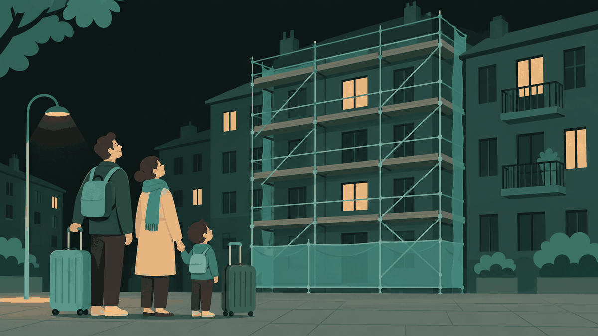
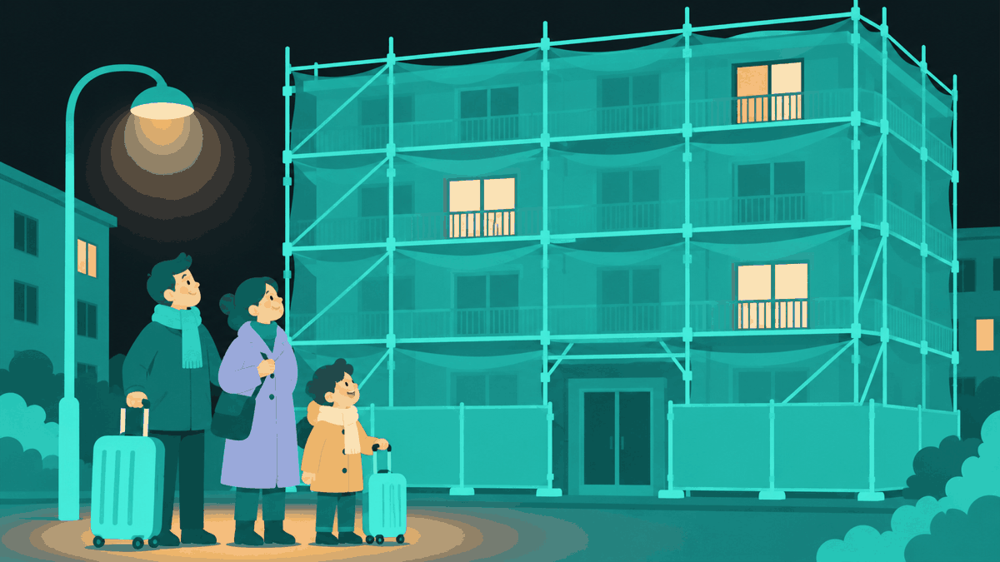
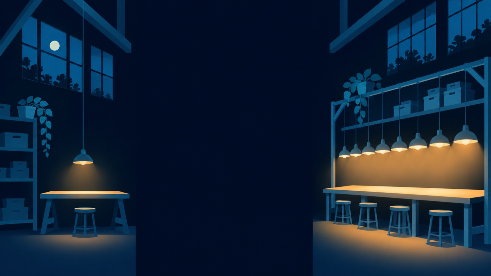

## What we will walk through {.divider}

1Architecture
2Retrieval
3Answer Generation
4Overall score
5Cost

::: {.cap}
Two submissions out of one pipeline, traced through a single request.
:::

## What the track asks

::: {.eyebrow}
119 requests · one cited answer each
:::

::: {.diagram}
{fig-alt="Two inputs on the left: the ClimbMix collection, drawn as a stack of documents reachable only through one hosted BM25 search endpoint, and the 119 requests, each a paragraph of context followed by several questions. One output on the right: a single written answer, drawn as lines of prose where every line ends in a citation marker, under two hard rules — at most 1,024 words, and every statement cited."}
:::

## The request we will follow

::: {.trace-step}
The example · rag2026-18 · one of the 119
:::

::: {.pull}
Six weeks of housing for a family of three — without booking
[something illegal or unreliable]{.hl}.
:::

::: {.grid-2}
::: {.scene}
{.scene-slate fig-alt="Two adults and a small child stand on a pavement with two wheeled suitcases at night, looking up at an apartment building wrapped in construction scaffolding and safety netting — the apartment being repaired while they need somewhere else to stay. A street lamp and a few windows glow warm."}
{.scene-forest aria-hidden="true"}
:::

::: {.redact}
Our family of three may need furnished temporary housing in New York City for
about six weeks **while our apartment is repaired**.

… Airbnb/Vrbo, an extended-stay hotel, corporate housing, or a short sublet?

… how should we compare the real costs, safety, cancellation risk, space,
location, and day-to-day practicality,

… especially **with a child** and remote work needs?
:::
:::

::: {.cap}
Eight things asked at once, in one paragraph.
:::
## Retrieval {.divider .divider-img}

::: {.secshot}
{fig-alt="A towering wall of small card-catalogue drawers fills the left edge of the frame and another fills the right. On the left a few drawers are pulled open and glow warm, with pale cards fanned above them, and a figure seen from behind reaches up to one while holding a lantern. Every other drawer is shut and dim. The space down the middle is dark and empty."}
:::

## Planning: how it works

::: {.diagram}
{fig-alt="The request goes into a single DeepSeek call, which returns up to eight subnarratives, each carrying one to three plain BM25 queries shown as dots. The untouched request is kept as its own search lane. The planner never sees a document and is never called again."}
:::

## Planning: this request

::: {.trace-step}
The example · 8 subnarratives created for this one request
:::

::: {.nargrid}

<svg class="glyph qico" viewBox="-16 -16 32 32" aria-hidden="true"><path d="M-11 -8H-7M-3 -8H11M-11 0H-7M-3 0H11M-11 8H-7M-3 8H6" fill="none" stroke="currentColor" stroke-width="2.4" stroke-linecap="round" stroke-linejoin="round"/></svg>What options exist?

<svg class="glyph qico" viewBox="-16 -16 32 32" aria-hidden="true"><path d="M-7 10V-6M7 10V-11M-13 10H13" fill="none" stroke="currentColor" stroke-width="2.4" stroke-linecap="round" stroke-linejoin="round"/></svg>How do the four types compare?

<svg class="glyph qico" viewBox="-16 -16 32 32" aria-hidden="true"><circle cx="0" cy="0" r="10" fill="none" stroke="currentColor" stroke-width="2.4" stroke-linecap="round" stroke-linejoin="round"/><path d="M-7 7L7 -7" fill="none" stroke="currentColor" stroke-width="2.4" stroke-linecap="round" stroke-linejoin="round"/></svg>Which listings are illegal?

<svg class="glyph qico" viewBox="-16 -16 32 32" aria-hidden="true"><rect x="-12" y="-7.5" width="24" height="15" rx="2.5" fill="none" stroke="currentColor" stroke-width="2.4" stroke-linecap="round" stroke-linejoin="round"/><circle cx="0" cy="0" r="3.6" fill="none" stroke="currentColor" stroke-width="2.4" stroke-linecap="round" stroke-linejoin="round"/></svg>What does it really cost?

<svg class="glyph qico" viewBox="-16 -16 32 32" aria-hidden="true"><path d="M0 -11L9 -7.5V1C9 7 4.8 10.6 0 12C-4.8 10.6 -9 7 -9 1V-7.5Z" fill="none" stroke="currentColor" stroke-width="2.4" stroke-linecap="round" stroke-linejoin="round"/><path d="M-4 0.5L-1 3.5L4.5 -2.5" fill="none" stroke="currentColor" stroke-width="2.4" stroke-linecap="round" stroke-linejoin="round"/></svg>Is it safe for a child?

<svg class="glyph qico" viewBox="-16 -16 32 32" aria-hidden="true"><rect x="-10" y="-8" width="20" height="18" rx="2.5" fill="none" stroke="currentColor" stroke-width="2.4" stroke-linecap="round" stroke-linejoin="round"/><path d="M-10 -2.5H10M-5 -12V-5M5 -12V-5M-3 2.5L3 7M3 2.5L-3 7" fill="none" stroke="currentColor" stroke-width="2.4" stroke-linecap="round" stroke-linejoin="round"/></svg>What if we cancel?

<svg class="glyph qico" viewBox="-16 -16 32 32" aria-hidden="true"><path d="M-11 -4V-11H-4M4 -11H11V-4M11 4V11H4M-4 11H-11V4" fill="none" stroke="currentColor" stroke-width="2.4" stroke-linecap="round" stroke-linejoin="round"/></svg>Is there room to work?

<svg class="glyph qico" viewBox="-16 -16 32 32" aria-hidden="true"><path d="M0 12C0 12 9 -1 9 -7A9 9 0 1 0 -9 -7C-9 -1 0 12 0 12Z" fill="none" stroke="currentColor" stroke-width="2.4" stroke-linecap="round" stroke-linejoin="round"/><circle cx="0" cy="-7" r="3.2" fill="none" stroke="currentColor" stroke-width="2.4" stroke-linecap="round" stroke-linejoin="round"/></svg>Is the location practical?

:::

## The queries each angle became

::: {.qgrid .qpair}

<svg class="glyph qico" viewBox="-16 -16 32 32" aria-hidden="true"><path d="M-11 -8H-7M-3 -8H11M-11 0H-7M-3 0H11M-11 8H-7M-3 8H6" fill="none" stroke="currentColor" stroke-width="2.4" stroke-linecap="round" stroke-linejoin="round"/></svg>What options exist?

<code>furnished temporary housing New York City family three six weeks</code>
<code>short term furnished rental NYC family child</code>

<svg class="glyph qico" viewBox="-16 -16 32 32" aria-hidden="true"><path d="M-7 10V-6M7 10V-11M-13 10H13" fill="none" stroke="currentColor" stroke-width="2.4" stroke-linecap="round" stroke-linejoin="round"/></svg>How do the four types compare?

<code>Airbnb vs extended stay hotel vs corporate housing vs sublet comparison</code>
<code>short term rental types NYC family advantages disadvantages</code>

:::

::: {.cap}
Two of the eight — the other six look the same, and all of them are in the appendix.
:::

## Searching: how it works

::: {.diagram}
{fig-alt="One BM25 query lane, stage by stage: up to 1,000 documents retrieved, chunked and reranked down to at most 100 kept passages, reduced to at most 40 selected passages, producing at most 20 nugget claims. The nugget stage is drawn in amber with a dashed edge because the answer may use those claims but must always cite the passage instead."}
:::

::: {.cap}
Every number is a **per-query ceiling**, not a total.
:::
## Reranking: a document becomes passages

::: {.diagram}
{fig-alt="One retrieved document, drawn with two more stacked behind it because BM25 returned up to a thousand, is cut into four overlapping windows of 3,500 characters with 350 of overlap, drawn as cards that overlap each other. The reranker mxbai-rerank-base-v2 then scores each window against this lane's query: window two scores 0.81 and window one 0.74 and both are kept, while window three at 0.22 and window four at 0.09 are dropped. A note says what moves on is windows, not documents, at most 100 per query."}
:::

## Answer Generation {.divider .divider-img}

::: {.secshot}
{fig-alt="A quiet study at night. On the left a desk and chair under a warm pool of lamplight, with a blank cream sheet and a few loose pages on it. On the right a tall window with warm light falling through, and a low bookshelf beneath. The space down the middle is dark and empty."}
:::

## Single-pass: Sol alone

::: {.diagram}
{fig-alt="A two-lane strip. Sol, marked with a sun, writes the answer in one call. Local code, marked with angle brackets, then validates it against three things: the output schema, that every citation names a document the topic may cite, and a limit of 1,024 words. A dashed arrow runs back to Sol for one retry, used on two of the 119 requests. The result is 119 validated answers, one model call each."}
:::

## Multi-stage: the work changes hands

::: {.diagram}
{fig-alt="A three-lane strip fed by the same sealed evidence. Luna is a crescent moon, Sol a sun, local code a pair of angle brackets. The path zigzags between lanes seven times: Luna plans, Sol writes the draft, Luna audits each evidence group returning at most six cards per group, local code merges them, Sol proposes at most three edits, Luna screens each against five booleans that must all pass, and local code applies only what passed. One pass through the stages, not a repeating loop; if revision fails the already validated draft stands."}
:::

## The two places Luna is used

::: {.diagram}
{fig-alt="Two columns. Left, step one: Luna writes the plan, 3 to 8 obligations, one shown in plain words — cover legality and reliability, in about 140 words, using evidence c003, c011 and c014 — with an arrow down to the sentence Sol wrote from it in the submitted answer, about verifying whether the host is registered with the city or qualifies for Class B status. Right, step two: Luna screens each edit against five true-or-false checks — support, atomicity, materiality, redundancy, replacement safety — each with a plain-words gloss, and all five must pass or the edit is dropped. Notes say Luna never writes a sentence of the answer and local code does the editing."}
:::

## Single-pass vs multi-stage

::: {.trace-step}
The example · rag2026-18
:::

::: {.grid-2}
::: {.card .card-ret}
[<svg class="glyph g-sun" viewBox="-16 -16 32 32" aria-hidden="true"><circle cx="0" cy="0" r="4.8" fill="none" stroke="currentColor" stroke-width="2.4" stroke-linecap="round" stroke-linejoin="round"/><path d="M0 -11.5V-8.4M0 8.4V11.5M-11.5 0H-8.4M8.4 0H11.5M-8.1 -8.1L-5.9 -5.9M5.9 5.9L8.1 8.1M8.1 -8.1L5.9 -5.9M-5.9 5.9L-8.1 8.1" fill="none" stroke="currentColor" stroke-width="2.4" stroke-linecap="round" stroke-linejoin="round"/></svg>Single-pass · Sol alone]{.card-label}
**22 statements · 504 words**

504 words of the 1,024-word ceiling
:::

::: {.card .card-gen}
[<svg class="glyph g-moon" viewBox="-16 -16 32 32" aria-hidden="true"><path d="M9 0.9A9.8 9.8 0 1 1 -0.9 -9A7.6 7.6 0 0 0 9 0.9Z" fill="none" stroke="currentColor" stroke-width="2.4" stroke-linecap="round" stroke-linejoin="round"/></svg><svg class="glyph g-sun" viewBox="-16 -16 32 32" aria-hidden="true"><circle cx="0" cy="0" r="4.8" fill="none" stroke="currentColor" stroke-width="2.4" stroke-linecap="round" stroke-linejoin="round"/><path d="M0 -11.5V-8.4M0 8.4V11.5M-11.5 0H-8.4M8.4 0H11.5M-8.1 -8.1L-5.9 -5.9M5.9 5.9L8.1 8.1M8.1 -8.1L5.9 -5.9M-5.9 5.9L-8.1 8.1" fill="none" stroke="currentColor" stroke-width="2.4" stroke-linecap="round" stroke-linejoin="round"/></svg>Multi-stage · Luna and Sol]{.card-label}
**38 statements · 800 words**

800 words of the 1,024-word ceiling

<svg class="glyph" viewBox="-16 -16 32 32" aria-hidden="true"><path d="M9 0.9A9.8 9.8 0 1 1 -0.9 -9A7.6 7.6 0 0 0 9 0.9Z" fill="none" stroke="currentColor" stroke-width="2.4" stroke-linecap="round" stroke-linejoin="round"/></svg>plans<i>→</i><svg class="glyph" viewBox="-16 -16 32 32" aria-hidden="true"><circle cx="0" cy="0" r="4.8" fill="none" stroke="currentColor" stroke-width="2.4" stroke-linecap="round" stroke-linejoin="round"/><path d="M0 -11.5V-8.4M0 8.4V11.5M-11.5 0H-8.4M8.4 0H11.5M-8.1 -8.1L-5.9 -5.9M5.9 5.9L8.1 8.1M8.1 -8.1L5.9 -5.9M-5.9 5.9L-8.1 8.1" fill="none" stroke="currentColor" stroke-width="2.4" stroke-linecap="round" stroke-linejoin="round"/></svg>drafts<i>→</i><svg class="glyph" viewBox="-16 -16 32 32" aria-hidden="true"><path d="M9 0.9A9.8 9.8 0 1 1 -0.9 -9A7.6 7.6 0 0 0 9 0.9Z" fill="none" stroke="currentColor" stroke-width="2.4" stroke-linecap="round" stroke-linejoin="round"/></svg>audits<i>→</i><svg class="glyph" viewBox="-16 -16 32 32" aria-hidden="true"><circle cx="0" cy="0" r="4.8" fill="none" stroke="currentColor" stroke-width="2.4" stroke-linecap="round" stroke-linejoin="round"/><path d="M0 -11.5V-8.4M0 8.4V11.5M-11.5 0H-8.4M8.4 0H11.5M-8.1 -8.1L-5.9 -5.9M5.9 5.9L8.1 8.1M8.1 -8.1L5.9 -5.9M-5.9 5.9L-8.1 8.1" fill="none" stroke="currentColor" stroke-width="2.4" stroke-linecap="round" stroke-linejoin="round"/></svg>revises<i>→</i><svg class="glyph" viewBox="-16 -16 32 32" aria-hidden="true"><path d="M9 0.9A9.8 9.8 0 1 1 -0.9 -9A7.6 7.6 0 0 0 9 0.9Z" fill="none" stroke="currentColor" stroke-width="2.4" stroke-linecap="round" stroke-linejoin="round"/></svg>screens
:::
:::

::: {.cap}
Same evidence, same ceiling. Multi-stage made **16 more statements**.
:::
## Nugget coverage, all 42 scored topics

::: {.diagram}
{fig-alt="Three groups of paired bars on a nought-to-one scale, one per judged collection, single-pass above multi-stage in each. NIST human rubrics over 17 narratives: 0.774 against 0.874, multi-stage ahead on 8, tied 8, behind 1. NIST human nuggets over 25 narratives: 0.570 against 0.658, ahead on 18, tied 7, behind 0. Auto-generated nuggets over 25 narratives: 0.128 against 0.250, ahead on 22, tied 3, behind 0. A note says all three rubrics put multi-stage ahead, that single-pass covered more on exactly one of the 42 narratives, and that levels are not comparable between collections."}
:::

::: {.cap}
On rag2026-18 multi-stage wrote: *"if the apartment repairs involve **lead
hazards**, ask whether the temporary unit has been made lead-safe."*

The request said *repairs* and *a child* in different sentences.
"Lead" never appears in the single-pass answer.
:::

## Overall score {.divider .divider-img}

::: {.secshot}
{fig-alt="A dark hall. A tall board of small panels fills the left edge and a matching board the right, most panels dim and a scattered few glowing warm. Two small figures stand at the lower left looking up at them. The space down the middle is dark and empty."}
:::

## What the organizers said about rag2026-18

::: {.trace-step}
One topic of the 42 — not the overall result
:::

::: {.diagram}
{fig-alt="Two groups of three bars on a nought-to-one scale. Vital nuggets supported: single-pass 0.857, multi-stage 1.000, field median 0.857. All nuggets supported: single-pass 0.929, multi-stage 1.000, field median 0.786. Beside them, how the assessors scored it: a person was shown one answer of ours and one from another team, side by side, and picked one — each of those is a battle. Single-pass fought ten, seven preferred and three lost; multi-stage fought six, six preferred and none lost. Our two answers never met."}
:::

## When the two measures disagree

::: {.trace-step}
A different topic · rag2026-13, a founder scaling a startup
:::

::: {.diagram}
{fig-alt="Two panels. The automated rubric: all nuggets supported, single-pass 1.000 against multi-stage 0.857, with an arrow marking single-pass ahead. The human assessors: single-pass preferred in 5 of its 10 battles, multi-stage in 8 of its 12, with an arrow marking multi-stage ahead. The two arrows point at different runs."}
:::

::: {.cap}
Same two answers, opposite ranking.
:::

## How often they disagree

::: {.diagram}
{fig-alt="Across the 42 scored topics the two measures agree on 20, all of them favouring multi-stage; they disagree on 5; and on 17 one measure is exactly tied. The five disagreements are listed with the run each measure puts ahead: rag2026-13, rubric single-pass 1.000 against 0.857 while assessors favour multi-stage 67 per cent against 50; rag2026-59, rubric multi-stage 1.000 against 0.800 while assessors favour single-pass 67 against 58; rag2026-97, rubric multi-stage 1.000 against 0.714, assessors single-pass 55 against 50; rag2026-2, rubric multi-stage 0.833 against 0.667, assessors single-pass 40 against 38; and rag2026-109, rubric multi-stage 0.667 against 0.611 while assessors favour single-pass 69 against 29, the widest gap on the list."}
:::

::: {.cap}
Not a one-off, and not typical either.
:::

## Overall: 42 scored topics

::: {.diagram}
{fig-alt="A grid of 42 squares, one per scored topic: 26 filled in the multi-stage colour where multi-stage supported more nuggets, 15 outlined where the two tied exactly, and 1 filled in the single-pass colour where single-pass did better. Below, each run's assessor record as a share of its own battles: multi-stage won 62.9 per cent of 399, single-pass 45.0 per cent of 422."}
:::

::: {.boundary}
Every number here is the organizers' own, from the score files they released.
Multi-stage costs several extra model calls per topic for this. Nothing here is
**a claim that it is novel** — only that the extra passes did something visible.
:::
## Cost {.divider .divider-img}

::: {.secshot}
{fig-alt="A dark workshop at night. On the left a single lamp hangs low over an empty bench, lighting a small circle. On the right a tall rack of many lit lamps throws a much larger pool of warm light. The space down the middle is dark and empty."}
:::

## What the second pass cost

::: {.eyebrow}
Model calls across all 119 requests
:::

::: {.diagram}
{fig-alt="Two panels. Paid once: one planner call per request, 119 in all, plus one nuggetizer call per subnarrative, 691 in all, giving 810 shared model calls; beneath, 1,787 BM25 searches and the local-GPU reranking, which cost no model calls. Paid once per strategy: single-pass 121 calls drawn as a short bar, multi-stage 1,167 drawn as a bar about ten times longer, which is 9.6 times the calls for the same evidence, or 1 against 7 to 12 per request. A note says this counts calls and not money, because tokens were never metered."}
:::

::: {.cap}
Retrieval is paid once. Only the writing is paid twice.
:::

## Where that leaves the architecture

::: {.diagram}
{fig-alt="The same five components as the opening slide, left to right: Plan with deepseek-v4-flash, Search with Pyserini BM25 over ClimbMix, Rerank with mxbai-rerank-base-v2, Select with all-MiniLM-L6-v2, and Write with gpt-5.6-sol and gpt-5.6-luna. The chain forks at the end into three ranked retrieval files and two answer files."}
:::

## Everything here is public

::: {.grid-2}
::: {.card .card-ret}
[Per-topic scores]{.card-label}
[Organizer Score Explorer](https://npatta01.github.io/trec_rag_2026/reports/2026-organizer-score-explorer.html)

All 530 released rows, filterable.
:::

::: {.card .card-ret}
[The full trace]{.card-label}
[Retrieval Quality Analysis](https://npatta01.github.io/trec_rag_2026/reports/2026-retrieval-nugget-coverage.html) ·
[per-topic trace CSV](https://github.com/npatta01/trec_rag_2026/releases/tag/trec-rag-2026-artifacts-v1)

Every subnarrative, query and nugget, all 119 topics.
:::

::: {.card .card-gen}
[Both answers, judged]{.card-label}
[rag26-ss1](https://npatta01.github.io/trec_rag_2026/reports/2026-ragdoll-rag26-ss1.html) ·
[rag26-ms1-final](https://npatta01.github.io/trec_rag_2026/reports/2026-ragdoll-rag26-ms1-final.html)

Per-citation support judgments.
:::

::: {.card .card-plain}
[How it was built]{.card-label}
[Architecture walkthrough](https://npatta01.github.io/trec_rag_2026/reports/2026-competition-architecture.html) ·
[project hub](https://npatta01.github.io/trec_rag_2026/)
:::
:::

::: {.cap}
Happy to walk through any of it — rag2026-18 and rag2026-13 are in the coverage
report and both RAGDoll reports, so the whole path is checkable.
:::

## Appendix {.divider}

::: {.cap}
The Retrieval submission — a separate, weaker run, kept back here for questions.
:::

## The Retrieval submission

::: {.diagram}
{fig-alt="Four horizontal lanes for one narrative, each plotting its documents by score. The top is the untouched narrative, the three below are facet lanes. Each lane carries its own dashed cutoff line and the four sit at four different places, because each is the median plus 2.5 times 1.4826 times that lane's median absolute deviation. Documents right of a line are filled and admitted, those left are hollow and dropped, admitting 6, 4, 9 and 3. A band below says the union is the candidate core, and that depth runs from 1 to 121 documents over 61 distinct depths, averaging about 36, for 4,246 rows per run."}
:::

::: {.cap}
That identical set went out three times — ordered by narrative-plus-subnarrative,
by evidence breadth, and by narrative alone. I hashed every `(topic, document)`
pair across the three files: same set, different order, so all three scored the
same per topic.
:::

## How the Retrieval run scored

::: {.diagram}
{fig-alt="Three paired bars comparing our retrieval run with the field median. Precision: ours 0.4116 against 0.3499. Recall: ours 0.0897 against 0.1002. Documents returned per topic: ours 38.6 against 100.0, roughly a third as many. Each pair is scaled to its own larger value."}
:::

::: {.cap}
Because the three runs hold the same documents, they scored identically per
topic — so this measures **what the cutoff selected**, not how it was ordered.
We return about a third as many documents as the field median and are more
precise for it; recall is the price.
:::

## Appendix · query lanes 1–4

::: {.trace-step}
rag2026-18 · 8 subnarratives × 2 queries = 16, plus the untouched request = 17
:::

::: {.qgrid}

<svg class="glyph qico" viewBox="-16 -16 32 32" aria-hidden="true"><path d="M-11 -8H-7M-3 -8H11M-11 0H-7M-3 0H11M-11 8H-7M-3 8H6" fill="none" stroke="currentColor" stroke-width="2.4" stroke-linecap="round" stroke-linejoin="round"/></svg>What options exist?

<code>furnished temporary housing New York City family three six weeks</code>
<code>short term furnished rental NYC family child</code>

<svg class="glyph qico" viewBox="-16 -16 32 32" aria-hidden="true"><path d="M-7 10V-6M7 10V-11M-13 10H13" fill="none" stroke="currentColor" stroke-width="2.4" stroke-linecap="round" stroke-linejoin="round"/></svg>How do the four types compare?

<code>Airbnb vs extended stay hotel vs corporate housing vs sublet comparison</code>
<code>short term rental types NYC family advantages disadvantages</code>

<svg class="glyph qico" viewBox="-16 -16 32 32" aria-hidden="true"><circle cx="0" cy="0" r="10" fill="none" stroke="currentColor" stroke-width="2.4" stroke-linecap="round" stroke-linejoin="round"/><path d="M-7 7L7 -7" fill="none" stroke="currentColor" stroke-width="2.4" stroke-linecap="round" stroke-linejoin="round"/></svg>Which listings are illegal?

<code>illegal short term rental NYC avoid scams</code>
<code>unreliable temporary housing New York City red flags</code>

<svg class="glyph qico" viewBox="-16 -16 32 32" aria-hidden="true"><rect x="-12" y="-7.5" width="24" height="15" rx="2.5" fill="none" stroke="currentColor" stroke-width="2.4" stroke-linecap="round" stroke-linejoin="round"/><circle cx="0" cy="0" r="3.6" fill="none" stroke="currentColor" stroke-width="2.4" stroke-linecap="round" stroke-linejoin="round"/></svg>What does it really cost?

<code>real cost comparison short term rental NYC fees taxes</code>
<code>hidden costs temporary housing New York City</code>

:::

## Appendix · query lanes 5–8

::: {.qgrid}

<svg class="glyph qico" viewBox="-16 -16 32 32" aria-hidden="true"><path d="M0 -11L9 -7.5V1C9 7 4.8 10.6 0 12C-4.8 10.6 -9 7 -9 1V-7.5Z" fill="none" stroke="currentColor" stroke-width="2.4" stroke-linecap="round" stroke-linejoin="round"/><path d="M-4 0.5L-1 3.5L4.5 -2.5" fill="none" stroke="currentColor" stroke-width="2.4" stroke-linecap="round" stroke-linejoin="round"/></svg>Is it safe for a child?

<code>safety family short term rental New York City neighborhood</code>
<code>child safe temporary housing NYC</code>

<svg class="glyph qico" viewBox="-16 -16 32 32" aria-hidden="true"><rect x="-10" y="-8" width="20" height="18" rx="2.5" fill="none" stroke="currentColor" stroke-width="2.4" stroke-linecap="round" stroke-linejoin="round"/><path d="M-10 -2.5H10M-5 -12V-5M5 -12V-5M-3 2.5L3 7M3 2.5L-3 7" fill="none" stroke="currentColor" stroke-width="2.4" stroke-linecap="round" stroke-linejoin="round"/></svg>What if we cancel?

<code>cancellation policy short term rental NYC</code>
<code>flexible cancellation temporary housing New York City</code>

<svg class="glyph qico" viewBox="-16 -16 32 32" aria-hidden="true"><path d="M-11 -4V-11H-4M4 -11H11V-4M11 4V11H4M-4 11H-11V4" fill="none" stroke="currentColor" stroke-width="2.4" stroke-linecap="round" stroke-linejoin="round"/></svg>Is there room to work?

<code>space family short term rental NYC one bedroom</code>
<code>temporary housing space child remote work New York City</code>

<svg class="glyph qico" viewBox="-16 -16 32 32" aria-hidden="true"><path d="M0 12C0 12 9 -1 9 -7A9 9 0 1 0 -9 -7C-9 -1 0 12 0 12Z" fill="none" stroke="currentColor" stroke-width="2.4" stroke-linecap="round" stroke-linejoin="round"/><circle cx="0" cy="-7" r="3.2" fill="none" stroke="currentColor" stroke-width="2.4" stroke-linecap="round" stroke-linejoin="round"/></svg>Is the location practical?

<code>location convenience short term rental NYC public transit</code>
<code>temporary housing near work school New York City</code>

:::

## Appendix · what this was built on

::: {.eyebrow}
Every model and tool, with where to find it
:::

::: {.grid-2}
::: {.card .card-ret}
[Ours]{.card-label}

planning**deepseek-v4-flash** · [deepseek.com](https://www.deepseek.com/)
search**Pyserini** BM25 · Lin et al., SIGIR 2021 · [10.1145/3404835.3463238](https://doi.org/10.1145/3404835.3463238)
reranking**mxbai-rerank-base-v2** · [mixedbread-ai on Hugging Face](https://huggingface.co/mixedbread-ai/mxbai-rerank-base-v2)
dedup**all-MiniLM-L6-v2** · Reimers & Gurevych, EMNLP 2019 · [sentence-transformers](https://huggingface.co/sentence-transformers/all-MiniLM-L6-v2)
writing**gpt-5.6-sol** and **gpt-5.6-luna**

:::

::: {.card .card-gen}
[The organizers']{.card-label}

nuggets**AutoNuggetizer** · [arXiv:2411.09607](https://arxiv.org/abs/2411.09607) · [10.1145/3726302.3730090](https://doi.org/10.1145/3726302.3730090)
preferences**arena-rank**, Bradley–Terry · [lmarena/arena-rank](https://github.com/lmarena/arena-rank)
corpus**ClimbMix**, reachable only through the hosted BM25 endpoint
scoringrubric and nugget assignment with GPT-6.1 Sol, per the organizers' README

:::
:::

::: {.cap}
The three judged collections on the coverage slide are the organizers' own:
human rubrics, human-authored nuggets, and AutoNuggetizer's generated ones.
:::
